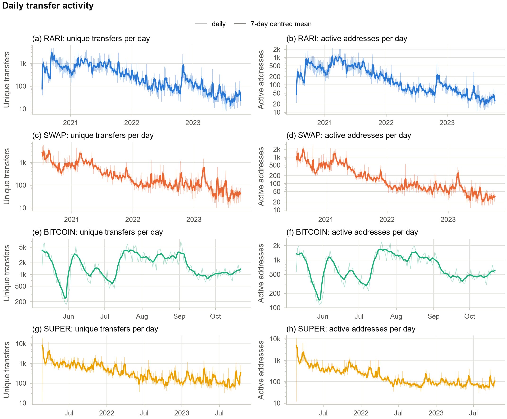
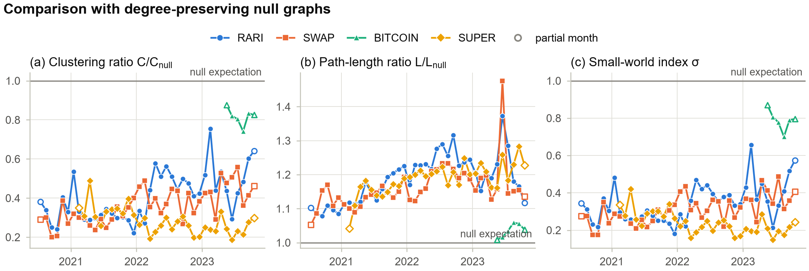
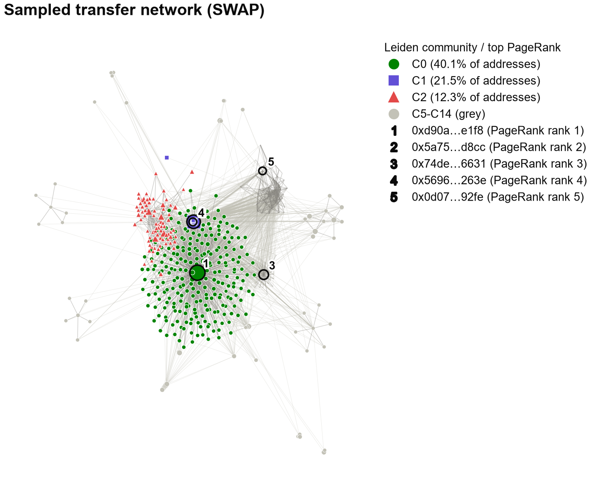
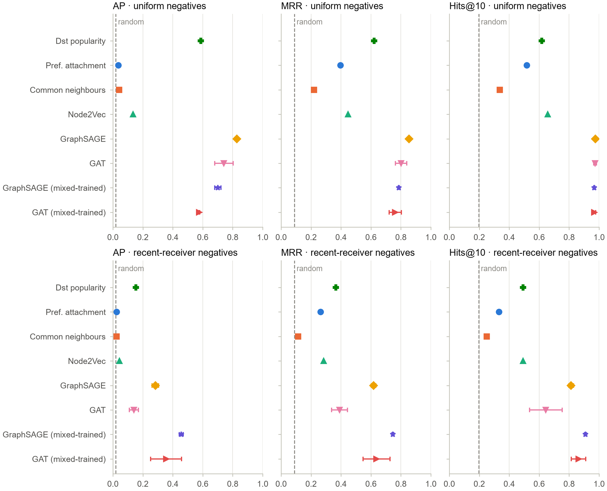
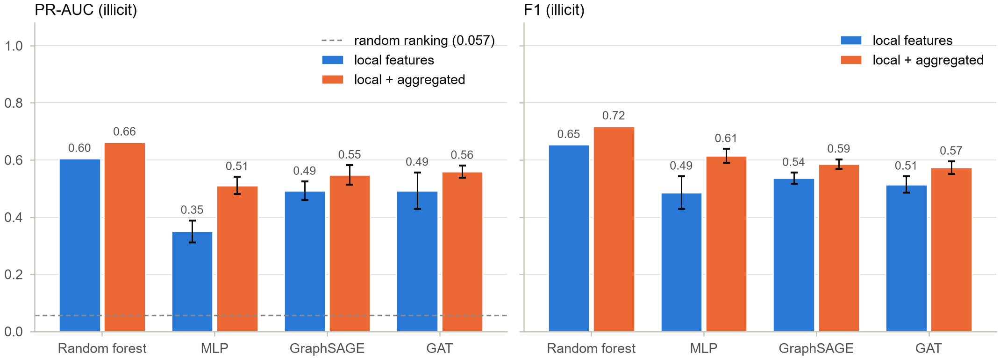

# Blockchain-GNN

**Social Network Analysis e Graph Neural Networks su reti di transazioni blockchain: ERC-20 e Bitcoin**

Progetto di Social Network Analysis e Graph Machine Learning. La domanda è se, e
in quali condizioni, rappresentare i dati blockchain come grafo fornisca
informazione utile che statistiche descrittive, euristiche di vicinato e modelli
tabellari non catturano già.

📄 Report completo: [`out/main.pdf`](out/main.pdf) (sorgente LaTeX in [`docs/report/main.tex`](docs/report/main.tex))

> In che misura le proprietà topologiche e temporali delle reti di transazioni
> blockchain permettono di individuare attori strutturalmente influenti e
> community, di prevedere interazioni future e di migliorare la classificazione
> supervisionata dei nodi rispetto a modelli che non usano la struttura del grafo?

La domanda è divisa in tre studi su dati e compiti diversi, che **non** vanno
letti come un unico benchmark:

| Studio | Compito | Dati |
|---|---|---|
| **A** | Social Network Analysis: concentrazione, distribuzioni, null model, centralità, community, evoluzione mensile | 4 token ERC-20 (RARI, SWAP, BITCOIN, SUPER) dal dataset TGS |
| **B** | Link prediction temporale di nuovi archi diretti | token SWAP, finestre settimanali |
| **C** | Classificazione lecito / illecito delle transazioni | Elliptic (Bitcoin) |

In tutti gli studi la valutazione rispetta l'ordine temporale: nessuna
informazione successiva al punto di split (archi, feature, normalizzazione,
etichette) entra nell'addestramento. Il criterio di successo non è la metrica
più alta, ma se la struttura **aggiunge** qualcosa a una baseline ragionevole
valutata con lo stesso protocollo.

## Risultati in breve

- **Studio A.** Le reti ruotano attorno a pochi hub che concentrano attività e
  volume (Gini del volume inviato tra 0,95 e 0,99), con una periferia a stella
  quasi senza triangoli e un forte ricambio mensile. Le code sono pesanti, ma i
  test **non supportano né la legge di potenza né l'ipotesi small-world**.
- **Studio B.** Con negativi uniformi gran parte del successo viene dal
  riconoscere gli indirizzi attivi: la baseline di sola popolarità del
  destinatario raggiunge già AP 0,59. Con negativi recenti solo GraphSAGE la
  batte in modo stabile (AP 0,28 contro 0,15). Addestrare con negativi misti
  porta l'AP a 0,46, ma a parità di attività del destinatario il guadagno è solo
  da 0,43 a 0,47.
- **Studio C.** Il grafo è utile quando le feature non contengono già il
  vicinato: con le sole feature locali le GNN superano l'MLP (PR-AUC 0,49 contro
  0,35). Con l'insieme completo il **Random Forest resta il migliore** (PR-AUC
  0,66), e tutti i modelli crollano dopo il cambiamento di distribuzione dello
  step 43.

**In sintesi:** il valore della struttura del grafo è reale ma condizionato. Va
misurato contro baseline che catturano popolarità e vicinato già disponibili,
con negativi difficili e con un protocollo cronologico. Senza questi controlli
il contributo delle GNN risulterebbe sovrastimato.

---

## Dataset

I dati grezzi **non** sono nel repository (`datasets/` è escluso e va trattato
come sola lettura).

- **Temporal Graph Scaling (TGS)** (Shirzadkhani et al., 2024): reti di
  trasferimento di 84 token ERC-20 (2017–2023), circa 128,9 milioni di righe. Un
  arco diretto `u → v` è un trasferimento del token, con l'importo in unità
  on-chain grezze. Va in `datasets/TGS_edgelists/<TOKEN>_edgelist.txt`.
- **Elliptic** (Weber et al., 2019): 203 769 transazioni Bitcoin e 234 355
  archi su 49 time step, con 166 feature anonimizzate. Il 2,2% delle transazioni
  è illecito, il 20,6% lecito e il 77,1% sconosciuto. Va in
  `datasets/elliptic_bitcoin_dataset/` (`elliptic_txs_features.csv`,
  `elliptic_txs_classes.csv`, `elliptic_txs_edgelist.csv`).

**Nota sugli snapshot TGS.** Ogni `snapshot` è una finestra di 7 giorni che
scorre di un giorno, quindi ogni trasferimento compare circa 7 volte. Prima di
ogni analisi i trasferimenti unici vengono ricostruiti (circa 19,1 milioni su
tutti i token). Usare gli snapshot sovrapposti come passi temporali avrebbe
fatto entrare nella storia gli stessi trasferimenti da prevedere, cioè un data
leakage.

Il token chiamato "BITCOIN" è un token ERC-20 su Ethereum e non ha relazione con
la blockchain Bitcoin di Elliptic.

---

## Studio A: Social Network Analysis di 4 token ERC-20

Per ogni token e finestra (intero periodo o mese) viene costruito un grafo
diretto di indirizzi, senza self-loop e senza mint/burn. Clustering, cammini,
assortatività e community sono calcolati sulla proiezione non diretta.


*Trasferimenti unici e indirizzi attivi al giorno (scala logaritmica).*

- **Reti non stazionarie.** RARI, SWAP e SUPER calano di quasi due ordini di
  grandezza in tre anni, e le variazioni dipendono da quanti indirizzi
  partecipano. Per questo l'analisi è fatta per mesi.
- **Code pesanti, non scale-free.** Il test formale (Clauset et al.) rifiuta la
  power-law in 20 casi su 28 tra grado, forza e volume, e la lognormale è spesso
  preferibile.
- **Concentrazione estrema del volume.** L'1% degli indirizzi muove tra il 76% e
  il 92% del volume. Metà del volume inviato passa per 42 indirizzi in SWAP e per
  appena 3 in BITCOIN.
- **Non small-world.** In ogni mese il clustering è *inferiore* a quello di
  grafi nulli con la stessa sequenza dei gradi e σ < 1. Le distanze brevi (2,4–3,2
  passi) si spiegano con i gradi, non con un'organizzazione small-world. Con una
  disassortatività tra −0,25 e −0,48, gli hub sono collegati a indirizzi
  periferici che non comunicano tra loro: una struttura a stella.


*Rapporti C/C_null e L/L_null e indice σ, mese per mese, contro 15 grafi nulli.*

- **Bow-tie.** In SWAP, BITCOIN e SUPER il grafo è un nucleo fortemente connesso
  (73–84% degli indirizzi) più un insieme OUT, mentre IN è assente. RARI ha un
  nucleo del 47% e un 32% di indirizzi in IN.
- **Ricambio.** Da un mese al successivo resta attivo solo il 10–48% degli
  indirizzi, e si ripete il 5–30% dei legami.
- **Community (Leiden).** Poche community grandi raccolgono il 94–97% degli
  indirizzi e sono collegate fra loro da molti scambi (modularità 0,30–0,52).
  Ognuna si raccoglie attorno a pochi indirizzi con PageRank alto.


*SWAP: sottografo campionato dalle 15 community principali. L'area dei nodi è
proporzionale a √PageRank.*

- **Indirizzi condivisi fra token.** Sono pochi (Jaccard ≤ 7%), ma centrali e
  tendono a stare nella stessa community in entrambi i token. Un indirizzo è fra
  i primi cinque per PageRank in tutti e quattro i token: secondo un'etichetta
  pubblica di Etherscan, verificata solo da quella fonte, è il router di scambio
  di MetaMask.

---

## Studio B: Link prediction temporale su SWAP

**Domanda:** quanta parte della capacità di prevedere un nuovo legame viene dal
sapere *chi* è attivo, e quanta dalla struttura che lega una specifica sorgente
ai suoi destinatari?

- **Compito.** Per ogni settimana *t*, un positivo è una coppia diretta `(u, v)`
  il cui primo trasferimento cade in *t*, con entrambi gli indirizzi già visti in
  passato. I modelli usano solo il grafo della storia precedente.
- **Split cronologico.** 4 settimane solo di storia, poi 115 di addestramento,
  25 di validazione e 25 di test. Il test ha 1 470 positivi, contro gli 83 333
  dell'addestramento.
- **Negativi.** Ogni positivo è confrontato con 50 negativi `(u, v')` con la
  stessa sorgente:
  - *uniform*: `v'` è un qualsiasi indirizzo della storia;
  - *recent*: `v'` ha ricevuto qualcosa nelle 4 settimane precedenti, seguendo
    Poursafaei et al. (2022) sui negativi facili.
- **Modelli.**
  - Dst popularity: baseline che guarda solo quanto riceve `v`;
  - preferential attachment e common neighbours;
  - Node2Vec con walk biased; la coppia (p, q) è scelta in validazione,
    p = 0,25 e q = 4;
  - GraphSAGE e GAT bi-relazionali, con negativi uniformi o misti.


*AP, MRR e Hits@10 sul test con negativi uniformi (sopra) e recenti (sotto).
Media ± deviazione standard su 3 seed.*

| Modello | Uniform AP · MRR | Recent AP · MRR | Recent, destinatario recente |
|---|---|---|---|
| Dst popularity | 0,59 · 0,62 | 0,15 · 0,37 | 0,33 · 0,58 |
| GraphSAGE | **0,83 · 0,86** | 0,28 · 0,62 | 0,43 · 0,70 |
| GraphSAGE (negativi misti) | 0,70 · 0,79 | **0,46 · 0,75** | **0,47 · 0,71** |
| GAT | 0,74 · 0,80 | 0,14 · 0,39 | 0,23 · 0,54 |
| GAT (negativi misti) | 0,58 · 0,76 | 0,36 · 0,64 | 0,37 · 0,65 |

- **Negativi facili.** Il vero destinatario era attivo in mediana una settimana
  prima, i negativi uniformi 117 settimane prima. Distinguerli non richiede di
  capire la struttura.
- **Due scorciatoie.** Addestrare solo con negativi uniformi insegna "attivo →
  positivo". Addestrare solo con negativi recenti insegna il contrario, "non
  attivo di recente → positivo": AP apparente 0,78, ma 0,999 sui positivi fuori
  dal pool recente e 0,01 con negativi uniformi. I **negativi misti** (½ uniform,
  ½ recent) eliminano entrambe le scorciatoie.
- **Guadagno reale piccolo.** Il confronto alla pari è la colonna "destinatario
  recente", dove positivo e negativi sono tutti attivi. Lì GraphSAGE con
  negativi misti passa solo da 0,43 a 0,47. Il resto del guadagno viene dai
  destinatari dormienti, compresi quelli degli hub, verso cui inviano 487 dei
  loro 574 positivi.
- **Limiti delle euristiche.** Common neighbours è vicino al caso, perché nella
  struttura a stella sorgente e destinatario hanno raramente vicini in comune.
- **Cold start.** Il 39% delle nuove coppie del test coinvolge un indirizzo mai
  visto. Queste coppie sono escluse, quindi i risultati valgono solo fra
  indirizzi già attivi.

---

## Studio C: Classificazione di transazioni Bitcoin (Elliptic)

- **Split cronologico.** Time step 1–34 per l'addestramento, 35–39 per la
  validazione, 40–49 per il test. La quota di illecite fra le transazioni
  etichettate scende dall'11,6% al 5,7%.
- **Modelli.**
  - Random Forest e MLP, che vedono solo le feature;
  - GraphSAGE e GAT, che aggregano anche i vicini.

  Ognuno è provato con le 93 feature *locali* e con le 165 *complete*, che
  aggiungono gli aggregati sui vicini a un passo.
- **Metriche.** PR-AUC e F1 della classe illecita. La soglia dell'F1 è scelta in
  validazione.


*PR-AUC e F1 della classe illecita sul test. Linea tratteggiata: prevalenza
(0,057).*

- **Random Forest migliore** con entrambi gli insiemi di feature: PR-AUC 0,60 e
  0,66, F1 0,65 e 0,72.
- **Il grafo serve solo con le feature locali.** Lì le GNN battono l'MLP (PR-AUC
  0,49 contro 0,35). Con l'insieme completo il vantaggio scende a 0,04–0,05,
  dentro 1–2 deviazioni standard, e sull'F1 si inverte: le feature aggregate
  catturano gran parte di ciò che le GNN ricavano dal vicinato.
- **Perché il vicinato è utile.** Le etichette hanno forte omofilia: un vicino di
  un'illecita è illecito nel 58% dei casi, contro il 6% atteso senza omofilia
  (assortatività r = 0,55).
- **Cambiamento di distribuzione.** Dallo step 43, dopo la chiusura di un dark
  market, tutti i modelli smettono quasi del tutto di riconoscere le illecite.
  La validazione non predice il test: l'MLP con feature locali è il migliore in
  validazione e il peggiore in test.

---

## Limiti principali

- **Identità.** Un indirizzo non è una persona né un'organizzazione. Hub,
  community e indirizzi condivisi sono descrittori strutturali, non trader,
  exchange o contratti reali.
- **Proiezione non diretta.** Clustering, cammini, assortatività e community
  dello Studio A ignorano il verso dei flussi.
- **Scelte dello Studio B.**
  - le coppie con un indirizzo mai visto sono escluse;
  - i negativi sono campionati, 50 per positivo;
  - la proporzione ½ dei negativi misti non è ottimizzata;
  - Node2Vec non esplora il regime q < 1, che torch-cluster 1.6.3 campiona in
    modo errato.
- **Iperparametri e seed.** Gli iperparametri delle GNN non sono ottimizzati in
  modo sistematico. Le GNN usano 3 seed nello Studio B e 5 nello Studio C, il
  Random Forest uno solo.
- **Elliptic.** Le etichette coprono solo il 22,9% delle transazioni. I
  risultati sono una valutazione su un benchmark, non una capacità di rilevare
  frodi reali.
- **Generalizzabilità.** Lo Studio A copre 4 token su 84 e lo Studio B uno solo.

---

## Struttura del repository

```
src/
  study_A/     SNA dei token ERC-20         (main.py + study_A.toml)
  study_B/     link prediction su SWAP      (main.py + study_B.toml, merge_runs.py)
  study_C/     classificazione Elliptic     (main.py + study_C.toml)
reports/
  study_A/runs/SNA/                 run usato nel report: config, figure, tabelle, metriche
  study_B/runs/COMPLETO_2_all/      run usato nel report (unione di COMPLETO_2 e COMPLETO_2_mixed)
  study_C/runs/COMPLETO/            run usato nel report
docs/report/   sorgente LaTeX del report (main.tex, references.bib)
out/main.pdf   report compilato
requirements.txt
```

Ogni cartella di run contiene la configurazione usata, le figure e le tabelle o
metriche CSV da cui sono tratti i numeri del report. I file intermedi pesanti
non sono pubblicati e si rigenerano dal codice: centralità, community e grafi
dello Studio A, predizioni e coppie campionate dello Studio B, modelli dello
Studio C.

## Riprodurre i risultati

Ambiente: Python 3.14 su Windows con GPU CUDA 12.8. torch è fissato alla 2.11
perché le wheel di `pyg-lib` e `torch-cluster` sono compilate per quella
versione.

```powershell
py -3.14 -m venv .venv
.venv\Scripts\python -m pip install -r requirements.txt
```

Ogni studio si lancia da `main.py` con i parametri nel file TOML dello studio,
senza argomenti da riga di comando. Il campo `run_id` del TOML decide la
cartella di output `reports/study_X/runs/<run_id>/`.

```powershell
.venv\Scripts\python src\study_A\main.py
.venv\Scripts\python src\study_B\main.py
.venv\Scripts\python src\study_C\main.py
```

**Riesecuzioni parziali dello Studio B.** Con il `run_id` di un run esistente
vengono ricalcolati solo i modelli in `models.enabled`. Le coppie di valutazione
vengono ricostruite e devono coincidere con quelle salvate. Il run del report
`COMPLETO_2_all` si ottiene unendo `COMPLETO_2` e `COMPLETO_2_mixed` con
`src/study_B/merge_runs.py`, che verifica che le coppie siano identiche.

Tutti i seed sono fissati nei file di configurazione.

## Riferimenti principali

- Shirzadkhani et al. (2024), *Towards Neural Scaling Laws for Foundation Models on Temporal Graphs* (dataset TGS).
- Weber et al. (2019), *Anti-Money Laundering in Bitcoin* (dataset Elliptic).
- Poursafaei et al. (2022), *Towards Better Evaluation for Dynamic Link Prediction*.
- Hamilton et al. (2017), *GraphSAGE*; Veličković et al. (2018), *GAT*; Grover & Leskovec (2016), *node2vec*.
- Clauset et al. (2009), power-law; Watts & Strogatz (1998) e Humphries & Gurney (2008), small-world; Traag et al. (2019), Leiden.

La bibliografia completa è in [`docs/report/references.bib`](docs/report/references.bib).

----
### Credits
This project has been developed as a coursework assigned for the class "Social Networks and Media Analysis", Spring 2026 (Instructor: prof. [Andrea Tagarelli](https://mlnteam-unical.github.io/)) at the DIMES Department, University of Calabria, Italy.

Developed with care and dedication by Mattia Corigliano.
